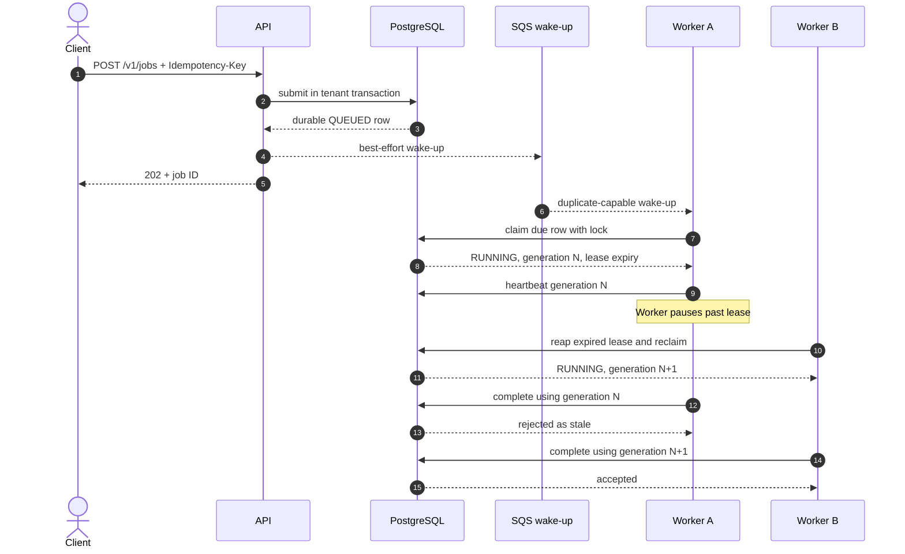

# ADR 0001: PostgreSQL-authoritative fenced jobs

- **Status:** Accepted
- **Scope:** API job submission, SQS wake-ups, worker claims, leases, retries, cancellation, and
  crash recovery
- **Related:** [Architecture](../architecture.md),
  [operations runbook](../runbooks/operations.md), and
  [ADR 0002](0002-transactional-artifact-outbox.md)

## Context

Backtests can outlive an HTTP request, an SQS visibility timeout, an ECS deployment, or a worker
process. The system must tolerate:

- duplicate, delayed, malformed, or missing wake-up messages;
- concurrent workers trying to claim the same job;
- a worker pausing beyond its lease and later resuming;
- process or task termination during simulation or publication;
- caller retries after an ambiguous HTTP response;
- cancellation racing with completion;
- tenant-level active-job quotas under concurrent submissions.

An SQS message cannot provide the complete queryable lifecycle, transactional idempotency, or
same-transaction quota enforcement. An in-process queue cannot survive process loss.

## Decision drivers

1. At-most-one valid owner at each job-state transition.
2. Recovery without operator-created duplicate runs.
3. Transactional idempotency and per-tenant quotas.
4. Safe behavior when SQS is unavailable or delivers more than once.
5. Bounded retry behavior with diagnosable failure classes.
6. Graceful deployment shutdown without charging the caller for an interrupted attempt.

## Options considered

### SQS as the job authority

Rejected. Visibility timeouts are not a fencing token, queue messages are awkward to query or
cancel, and API idempotency and tenant quotas would still require another transactional store.
A delayed consumer could continue after a message becomes visible to another worker.

### In-process or host-local queue

Rejected. It couples availability to one process and loses accepted work on restart.

### PostgreSQL as authority with SQS as an optional wake-up

Accepted. PostgreSQL already stores runs and tenant state, provides row locking and transactions,
and remains reachable by both API and workers. SQS improves wake-up latency and scaling but is not
needed for correctness.

## Decision

The `run_jobs` row is the durable job. SQS carries only a versioned `{job_id, tenant_id}` wake-up.
Workers always validate and claim the PostgreSQL row before doing work.

### Submission

- The idempotency scope is `(tenant_id, idempotency_key)`.
- PostgreSQL serializes submissions for one tenant with a transaction-scoped advisory lock.
- Reusing a key with the same canonical payload returns the existing job.
- Reusing a key with a different payload returns a conflict.
- `QUEUED`, `RUNNING`, and `WAITING_ARTIFACT` count toward the active-job quota.
- The API commits the job before attempting the optional SQS wake-up. A wake-up failure is logged;
  workers continue polling PostgreSQL.

### Claim and fence

- A claim selects one due `QUEUED` row ordered by `next_attempt_at`, creation time, and ID.
- PostgreSQL workers use `FOR UPDATE SKIP LOCKED`.
- Claiming increments both `attempts` and monotonic `lease_generation`, records `worker_id`, and
  sets `lease_expires_at` from database time.
- The default deployed lease is 30 seconds.
- The heartbeat thread runs approximately every one-third of the lease duration.
- Heartbeat, cancellation, success, failure, publication deferral, and administrative release
  compare status, worker ID, generation, and unexpired database-clock lease.

The generation is the fencing token. A stale worker is not allowed to commit a terminal job
transition even if it still has CPU time or network access.

### Retry and expiry

- Failures are classified as `TRANSIENT`, `PERMANENT`, or `INVARIANT`.
- Only transient failures retry, and only while `attempts < max_attempts`.
- Backoff is deterministic exponential delay with deterministic jitter: a five-second base and a
  300-second cap.
- An expired lease is reaped under a row lock. Depending on cancellation, artifact-outbox state,
  and attempt count, the row becomes `CANCELED`, `WAITING_ARTIFACT`, `SUCCEEDED`, `FAILED`, or
  `QUEUED`.
- Reaping runs opportunistically before claims, so no separate scheduler is required for
  correctness.

### Cancellation and shutdown

- Canceling `QUEUED` or `WAITING_ARTIFACT` is immediately terminal.
- Canceling `RUNNING` sets `cancel_requested`; heartbeat and engine checkpoints stop the attempt,
  then the current fenced owner records `CANCELED`.
- During SIGTERM/SIGINT, the worker stops computation and releases a still-owned lease. A
  non-canceled job returns to `QUEUED`, and the interrupted attempt is decremented so a deployment
  does not consume caller retry budget.
- If ownership has already changed, the old worker records no transition.

## Required invariants

1. SQS receipt or acknowledgement must never imply job ownership.
2. No terminal or retry transition may omit the lease fence.
3. Lease time must come from PostgreSQL, not a worker wall clock.
4. A worker must continue polling PostgreSQL when SQS is unavailable.
5. Job ID remains the run ID, making recovery of an already-persisted result idempotent.
6. New job states or transitions require database constraints, tests, API behavior, metrics, and
   runbook updates in the same change.

## Consequences

### Positive

- Duplicate and missing queue messages do not change correctness.
- Stale workers cannot overwrite a newer owner.
- Accepted jobs, quotas, idempotency, and cancellation remain queryable and transactional.
- Crash recovery can distinguish recomputation from artifact-only reconciliation.

### Negative

- PostgreSQL is on the worker coordination path and must be sized and monitored accordingly.
- Claiming across tenants requires a trusted worker database role with `BYPASSRLS`.
- Retry and lease code is more complex than a queue-only consumer.
- Reaping is driven by worker activity; a deployment with zero workers does not progress jobs.

## Operational implications

- Alert on repeated lease loss, no running workers, queue age, job failures, and RDS saturation.
- Treat SQS depth as a scaling hint, not the authoritative count of queued jobs.
- Never manually rewrite `worker_id`, `lease_generation`, or `lease_expires_at` while a lease is
  valid.
- Diagnose a job using its tenant, job ID, attempt, generation, and internal error reference.
- See the [operations runbook](../runbooks/operations.md) for tenant-safe queries and recovery
  procedures.

## Validation

The decision is enforced by:

- database constraints and indexes in Alembic revisions `0004`, `0006`, and `0009`;
- lifecycle and concurrency tests in `tests/test_job_leases.py` and
  `tests/test_service_job_lifecycle.py`;
- PostgreSQL role/RLS tests in `tests/test_postgres_security_integration.py`;
- worker cancellation and artifact recovery tests in `tests/test_artifact_outbox.py`.
