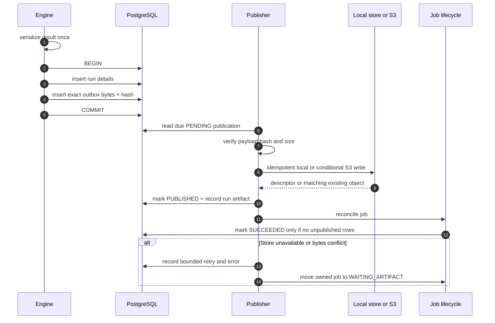

# ADR 0002: Transactional artifact outbox

- **Status:** Accepted
- **Scope:** Run persistence, result serialization, local/S3 publication, publication retries, and
  job success
- **Related:** [Architecture](../architecture.md),
  [operations runbook](../runbooks/operations.md), and
  [ADR 0001](0001-durable-fenced-jobs.md)

## Context

A successful simulation produces relational records and a serialized result artifact. PostgreSQL
and an object store do not share a transaction. A crash can occur:

- after the database commits but before an object write;
- after an object write but before its descriptor is recorded;
- while an object write is in flight;
- after a caller or worker retries the same run;
- during an S3 or KMS outage.

Recomputing after a publication failure is unsafe and wasteful: the original run already exists,
and a code or dependency change could produce different bytes. Marking a job successful before
publication leaves an externally visible result with a missing artifact.

## Decision drivers

1. A committed run and the bytes intended for publication must not diverge.
2. Publication retries must not rerun the simulation.
3. A different existing object must never be accepted as a successful publication; production
   writes must prevent replacement.
4. Recovery must be automatic, idempotent, and diagnosable.
5. Job success must mean both relational persistence and artifact publication completed.

## Options considered

### Publish first, then commit PostgreSQL

Rejected. A database failure leaves an unreferenced object, and a retry cannot safely determine
whether the object belongs to the same relational result.

### Commit PostgreSQL, then serialize or recompute for publication

Rejected. A crash can lose the serialization context, and recomputation can drift.

### Put artifact bytes on SQS

Rejected. SQS is a wake-up channel with message-size and redelivery semantics unsuited to durable
result payloads. It would also make the queue an unintended data store.

### Stage exact bytes in a transactional outbox

Accepted. The run and the exact serialized payload commit together. Publication becomes a
separate idempotent delivery step.

## Decision

The engine serializes the result exactly once. In the same PostgreSQL transaction that writes the
run and its orders, fills, equity, and journal, it inserts one `artifact_publications` row
containing:

- tenant and run identity;
- artifact kind;
- exact UTF-8 payload;
- SHA-256 and byte length;
- `PENDING` status and next-attempt time.

### Publication semantics

- The publisher recomputes SHA-256 and byte length from the staged payload before writing.
- Local publication flushes a temporary file, atomically installs it, and verifies the exact
  bytes of an existing destination on retry.
- S3 publication supplies the payload SHA-256 checksum and `If-None-Match: *`. A retry or
  concurrent-write response accepts an existing object only when its SHA-256 metadata and byte
  length match the staged descriptor.
- A matching existing object is an idempotent success.
- An existing object whose checked descriptor differs from the staged hash or size is an invariant
  violation, never a successful publication.
- After the store returns a matching descriptor, PostgreSQL records a `run_artifacts` descriptor
  and changes the outbox row to `PUBLISHED` in one transaction.

The local store is a development/test mechanism. Its flushed temporary file and atomic
replacement make installation crash-safe, and it verifies a destination found before a retry,
but it is not a cross-host write-once primitive. Production immutability comes from the S3
conditional write, versioning, IAM, and Object Lock. The application checks metadata and length
when an S3 key already exists; operational integrity sampling independently downloads and hashes
selected exact object versions.

### Retry and job state

- Publication failures retain `PENDING`, increment `attempts`, store bounded internal error text,
  and schedule deterministic exponential retry with a five-second base and 300-second cap.
- A worker processes a due artifact publication before claiming new simulation work.
- If simulation persistence succeeded but immediate publication failed, the fenced job becomes
  `WAITING_ARTIFACT`.
- Once every outbox row is published, reconciliation changes a recoverable job to `SUCCEEDED`.
- If a `WAITING_ARTIFACT` job is canceled, the job remains `CANCELED`; pending exact bytes may
  still be published for audit/recovery, but reconciliation does not resurrect the job.
- An expired worker lease inspects the outbox: pending rows lead to `WAITING_ARTIFACT`, and fully
  published rows allow direct reconciliation to `SUCCEEDED`.

## Required invariants

1. Run rows and their intended artifact bytes commit in the same database transaction.
2. Service execution stages a result artifact, and `SUCCEEDED` requires no unpublished artifact
   rows. Artifact-only reconciliation additionally requires at least one published row.
3. Publication always uses the staged payload; it never reconstructs bytes from mutable runtime
   state.
4. Production object keys are conditionally created and retained immutably. A checked-descriptor
   mismatch is an incident.
5. Artifact descriptors must match the staged hash and size.
6. Outbox mutation and artifact descriptors remain tenant-scoped and audited.

## Consequences

### Positive

- A storage outage does not require simulation recomputation.
- The database can explain every missing, pending, or published artifact.
- Retries are idempotent across worker crashes and concurrent recovery.
- Job success has a precise operational meaning.

### Negative

- Serialized artifacts temporarily consume PostgreSQL storage.
- Workers and the database must scan and retain retry metadata.
- Object-store verification can require an additional metadata read on retries or concurrent
  writes.
- Retention and database-capacity planning must include pending outbox payloads.

## Operational implications

- Alert on `artifact_deferred` log events and jobs in `WAITING_ARTIFACT`.
- Restore S3/KMS access before changing job rows; workers reconcile automatically.
- Never rerun a simulation merely to repair publication.
- Never overwrite a deterministic artifact key or manually mark an outbox row `PUBLISHED`.
- Investigate hash/size conflicts as integrity incidents.
- Monitor pending payload count, age, attempts, and total byte size with tenant-safe queries from
  the [operations runbook](../runbooks/operations.md).

## Validation

The decision is enforced by:

- Alembic revision `0009` and `ArtifactPublication` database constraints;
- `Database.stage_run_with_artifact`, publication state transitions, and immutable artifact stores;
- `tests/test_artifact_outbox.py`;
- worker lifecycle tests covering artifact deferral, crash recovery, and reconciliation.
