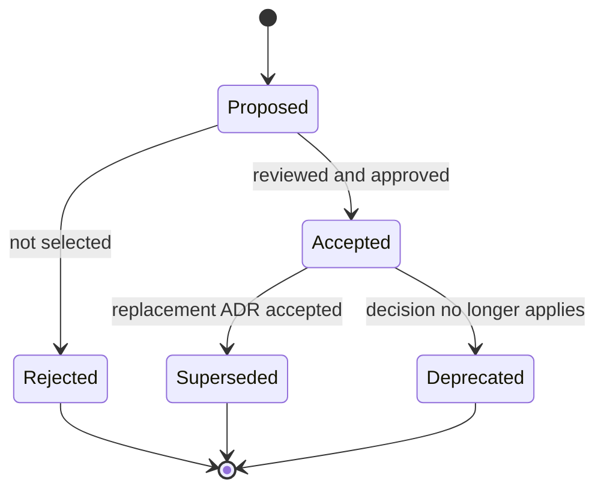

# Architecture decision records

Architecture decision records explain decisions that are expensive or unsafe to reverse without
coordination. They supplement the current [architecture](../architecture.md); they do not replace
code, migrations, tests, or runbooks.

## Index

| ADR | Status | Decision |
| --- | --- | --- |
| [0001](0001-durable-fenced-jobs.md) | Accepted | PostgreSQL-authoritative jobs with database-clock leases and generation fencing |
| [0002](0002-transactional-artifact-outbox.md) | Accepted | Transactional exact-byte outbox for immutable result publication |

## Lifecycle

Use one of these statuses:

- **Proposed**: under review and not yet authoritative.
- **Accepted**: implemented and authoritative.
- **Rejected**: considered but not selected.
- **Superseded**: replaced by a newer ADR; link both records.
- **Deprecated**: retained for history but no longer applies.

## Required ADR sections

New ADRs should include:

1. status and scope;
2. context and decision drivers;
3. options considered;
4. the decision and its invariants;
5. positive and negative consequences;
6. operational and migration implications;
7. validation or evidence;
8. links to related code, tests, runbooks, and ADRs.

Never edit an accepted ADR to conceal a changed decision. Add a superseding ADR and update the
status and links on the older record. Clarifications that do not alter the decision are allowed.
