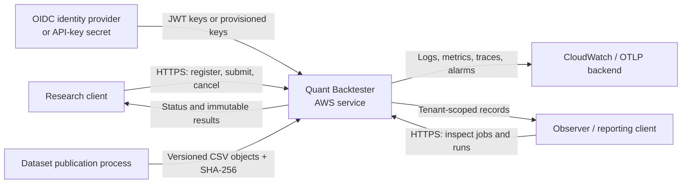
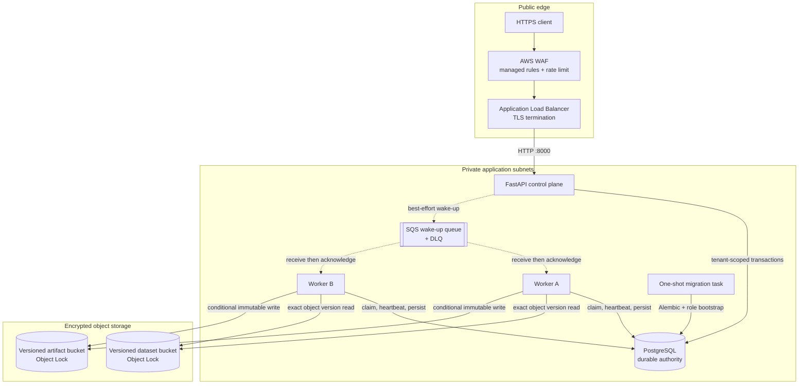
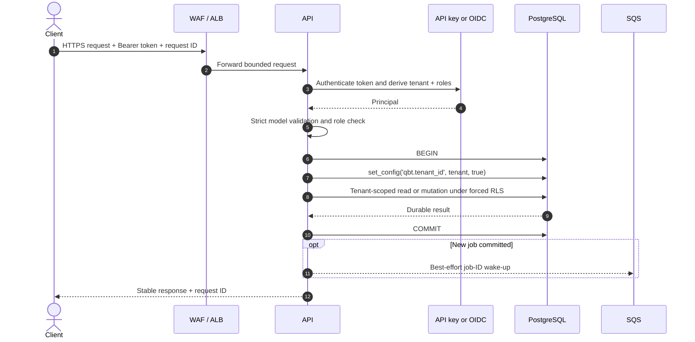
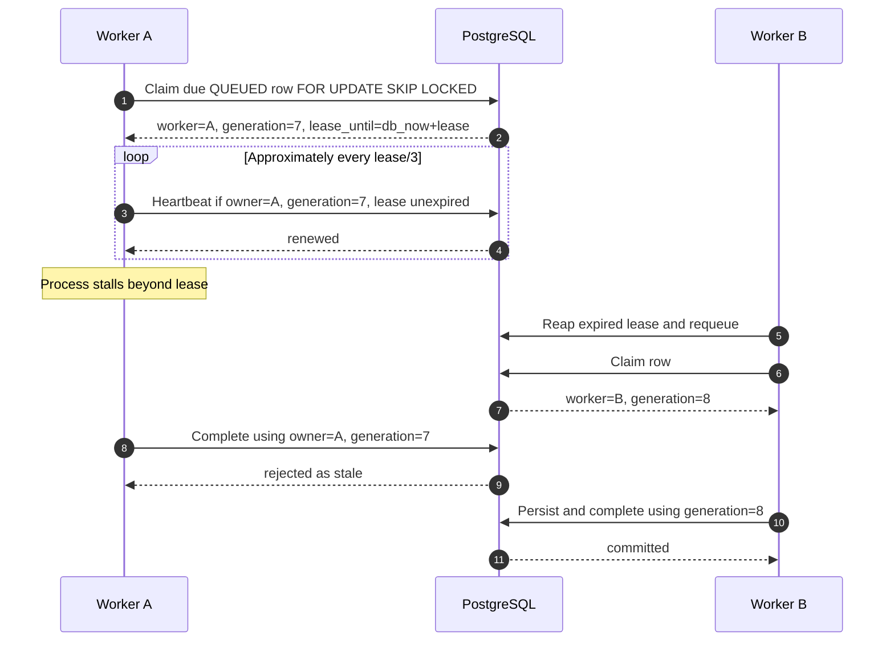
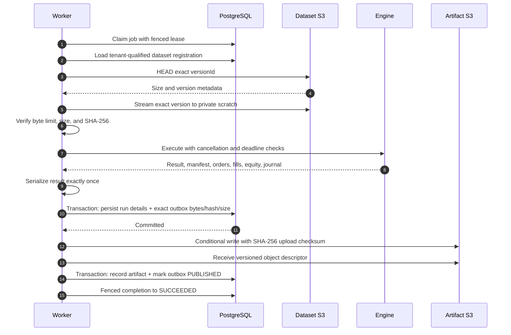
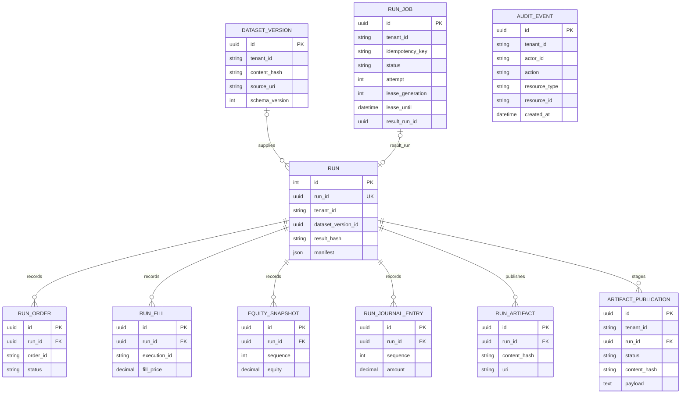
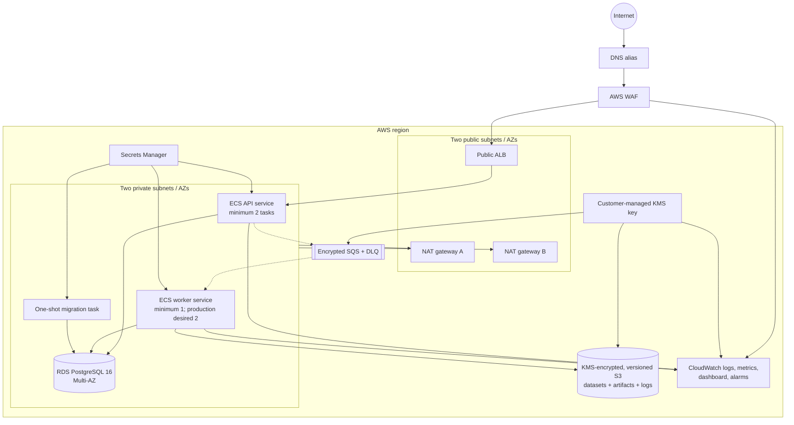
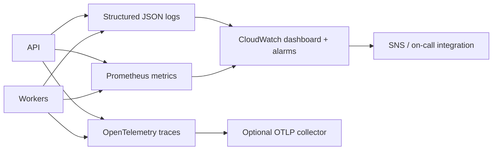

# Quant Backtester architecture

- Status: implemented
- Audience: maintainers, reviewers, platform engineers, security engineers, and on-call responders
- Last verified against the repository: 2026-07-29

This document describes the deployed service architecture and the correctness boundaries that
must survive implementation and infrastructure changes. For deployment, incident response, and
recovery procedures, use the [operations runbook](runbooks/operations.md). Architectural
decisions and their consequences are indexed in the [ADR directory](adr/README.md).

## Scope and system qualities

Quant Backtester is a deterministic, event-driven research engine exposed through a
multi-tenant control plane. The service accepts immutable dataset registrations and durable
backtest jobs, executes them asynchronously, stores normalized run records in PostgreSQL, and
publishes immutable result artifacts.

The architecture prioritizes these qualities, in order:

1. tenant isolation and least privilege;
2. deterministic, auditable results;
3. durable job execution under duplicate delivery, process loss, and retry;
4. accounting and artifact-integrity invariants;
5. bounded resource consumption and graceful degradation;
6. observable, reversible operations.

The following invariants are architectural contracts:

| Invariant | Enforcement |
| --- | --- |
| PostgreSQL is the job-state authority | SQS is used only as a best-effort wake-up; workers also poll durable rows |
| One tenant cannot read or mutate another tenant's control-plane data | explicit tenant context, forced PostgreSQL RLS, tenant-qualified foreign keys, and role grants |
| A stale worker cannot mutate a reassigned job | worker ID, monotonically increasing lease generation, and database-clock expiry are checked on every owned transition |
| A successful job has a persisted run and no unpublished artifact | run data and exact artifact bytes are staged transactionally; success is fenced on publication state |
| Published bytes stay bound to the staged result | staged SHA-256/size checks, atomic local installation or conditional S3 creation, and a matching database descriptor |
| Re-running identical semantic inputs produces the same result identity | canonical configuration, normalized data, strategy fingerprint, engine semantics, and versioned RNG streams |
| Financial records reconcile | fixed-precision persisted monetary values, balanced journal entries, and end-of-run reconciliation |
| Production input and compute cost are bounded | strict schemas plus request, dataset, symbol, event, equity-point, attempt, active-job, and run-time limits |
| Runtime identities cannot administer the database | separate API, worker, migration, execution, and task identities with no broad future grants |
| Audit records are append-only | database triggers reject audit updates and deletes |

## System context



The system does not source market data, manage OIDC identities, create Terraform remote-state
infrastructure, issue TLS certificates, or provide an interactive production research notebook.
Those are external responsibilities.

## Runtime components



### Component responsibilities

| Component | Owns | Must not own |
| --- | --- | --- |
| ALB and WAF | TLS entry point, target health, managed request filtering, per-IP rate limiting, access logs | authentication, authorization, or tenant identity |
| API | authentication, role checks, strict validation, dataset registration, idempotent submission, cancellation requests, tenant-scoped reads | long-running simulations, schema migration, or authoritative queue state |
| PostgreSQL | datasets, jobs, leases, runs, normalized execution records, artifact outbox, audit events, tenant policies | binary source datasets or published result objects |
| SQS | low-latency worker wake-up and queue-depth scaling signal | job payload or lifecycle truth |
| Worker | due-artifact recovery, fenced job claims, dataset verification, engine execution, persistence, publication, retry classification | public ingress or database administration |
| Dataset bucket | immutable, versioned CSV inputs under `datasets/` | tenant authorization or dataset registration metadata |
| Artifact bucket | immutable result bytes under `runs/` | run status or publication retry state |
| Migration task | forward schema migration and runtime-role creation/rotation | serving traffic or processing jobs |

## Control-plane request path



The operational middleware streams and bounds request bodies before model parsing. It accepts a
valid caller request ID or generates one, emits security headers, and records bounded-cardinality
HTTP metrics. Production responses add HSTS and a restrictive content security policy. API
documentation and the local console are disabled in staging and production.

Authentication modes are:

- `oidc`: verifies HTTPS issuer/JWKS configuration, audience, signature (`RS256` or `ES256`),
  expiry, issued-at time, subject, tenant claim, and roles claim;
- `api-key`: compares `SHA-256(pepper || token)` using constant-time comparison and supports a
  key ID, tenant, roles, and optional expiry;
- `disabled`: development and test only; configuration validation rejects it in staging and
  production.

Roles are hierarchical: `observer` can inspect tenant data and metrics, `researcher` additionally
registers datasets and submits or cancels jobs, and `admin` permits all current API actions.

### Durable and idempotent submission

`POST /v1/jobs` requires an `Idempotency-Key`. Submission takes a tenant-scoped PostgreSQL
transaction advisory lock before checking the `(tenant_id, idempotency_key)` uniqueness boundary:

- the same key and same canonical payload returns the existing job;
- the same key with a different payload returns `409 Conflict`;
- an active-job count at the tenant quota returns `429 Too Many Requests`;
- otherwise the job is committed as `QUEUED` before the API attempts an SQS wake-up.

A failed SQS send does not invalidate the accepted job. Workers poll PostgreSQL even when no
message arrives.

## Durable job execution

### State model

```mermaid
stateDiagram-v2
    [*] --> QUEUED: accepted durably
    QUEUED --> RUNNING: fenced claim
    QUEUED --> CANCELED: cancellation requested
    RUNNING --> QUEUED: transient failure or released shutdown
    RUNNING --> WAITING_ARTIFACT: run committed; publish deferred
    RUNNING --> SUCCEEDED: run persisted; artifact descriptor accepted
    RUNNING --> FAILED: permanent, invariant, or attempts exhausted
    RUNNING --> CANCELED: cooperative cancellation
    WAITING_ARTIFACT --> SUCCEEDED: artifact published and reconciled
    WAITING_ARTIFACT --> CANCELED: cancellation requested
    FAILED --> SUCCEEDED: previously staged artifact reconciled
    SUCCEEDED --> [*]
    FAILED --> [*]
    CANCELED --> [*]
```



`QUEUED`, `RUNNING`, and `WAITING_ARTIFACT` count toward the tenant active-job quota. The
`FAILED -> SUCCEEDED` recovery edge applies only when a run and its transactionally staged
artifact already exist; reconciliation cannot manufacture or recompute a result.

### Claim and fencing protocol



Claims use database time, not host clocks. PostgreSQL selects due jobs using
`FOR UPDATE SKIP LOCKED`, ordered by next-attempt time, creation time, and ID. A claim increments
both attempt count and lease generation, assigns the worker ID, and sets a lease expiry. Every
heartbeat, retry, wait-for-artifact, completion, cancellation, and shutdown release compares:

- status is still `RUNNING`;
- worker ID is unchanged;
- lease generation is unchanged;
- the database-clock lease is still valid.

The worker heartbeats independently while the engine cooperatively checks lease loss,
cancellation, process shutdown, and the maximum run duration. A heartbeat guard treats ownership
as lost before the local view reaches the lease boundary, reducing the chance of work continuing
through an uncertain lease.

The reaper classifies an expired job from durable evidence:

- a pending outbox row becomes `WAITING_ARTIFACT`;
- a fully published outbox becomes `SUCCEEDED`;
- a cancellation becomes `CANCELED`;
- an exhausted attempt budget becomes `FAILED`;
- otherwise the job returns to `QUEUED` with deterministic bounded backoff.

Failures are classified as transient, permanent, or invariant. Only transient failures retry.
Backoff is deterministic exponential delay with jitter, bounded by the configured base and cap.
Public errors expose a stable code; logs retain the internal error reference and exception detail.

For the reasoning behind this protocol, see
[ADR-0001: Durable jobs with generation-fenced leases](adr/0001-durable-fenced-jobs.md).

## Worker execution and artifact publication

Workers service due artifact publications before claiming new simulations. This allows a storage
recovery to drain persisted results without spending compute on duplicate runs.



In staging and production, a dataset must:

- already be registered for the job's tenant;
- use the authorized dataset bucket and `datasets/` prefix;
- identify exactly one S3 object `versionId`;
- provide a lowercase SHA-256 hash;
- satisfy configured size, symbol, event, ordering, and schema limits.

The worker downloads in bounded chunks to private `/tmp`, verifies size and hash, marks the local
copy read-only, and removes it after use. Local paths are a development-only mode and are confined
to the configured data root.

The engine serializes a result once. One database transaction then writes the run, normalized
orders, fills, equity snapshots, balanced journal, and an artifact-publication row containing the
exact UTF-8 payload, SHA-256, and byte count. Publication is:

- a flushed temporary file and atomic install for the local store, with byte-for-byte verification
  when the destination already exists;
- `If-None-Match` conditional creation for S3 with the expected SHA-256 upload checksum;
- idempotent when an existing local file matches exactly, or an existing S3 object has the
  expected SHA-256 metadata and byte length;
- an integrity incident when an existing object differs.

Storage failure after the database commit moves the job to `WAITING_ARTIFACT`. Any worker can
later publish the staged bytes and reconcile the job; simulation is not repeated. Cancellation
may leave those immutable evidence bytes publishable, but publication never resurrects a canceled
job. See
[ADR-0002: Transactional artifact outbox](adr/0002-transactional-artifact-outbox.md).

## Deterministic engine

```mermaid
flowchart LR
    Input["Registered CSV version"]
    Parse["Strict parse<br/>UTC normalization"]
    Warmup["Strategy warm-up<br/>orders prohibited"]
    Strategy["Strategy signals"]
    Execution["Execution simulation<br/>versioned keyed RNG"]
    Portfolio["Portfolio + balanced journal"]
    Risk["Risk gates"]
    EOD["End-of-data policy"]
    Metrics["Metrics + reconciliation"]
    Identity["Manifest + result hash"]
    Persist["Normalized persistence + outbox"]

    Input --> Parse --> Warmup --> Strategy
    Strategy --> Execution --> Portfolio --> Risk
    Risk --> Strategy
    Risk --> EOD --> Metrics --> Identity --> Persist
```



The parser rejects malformed optional values, inconsistent quoting, invalid timestamps,
non-finite or non-positive prices, unauthorized symbols, and unbounded unsorted input. Warm-up
events establish strategy state but cannot emit orders.

Execution supports market, limit, stop, and stop-limit orders; latency, participation limits,
queueing, partial fills, spread, impact, hard price bounds, and reduce-only intent are modeled.
Randomness comes from a stable per-order stream rather than call order. Portfolio cash and
journal arithmetic use `Decimal` quantized to eight fractional digits; PostgreSQL stores monetary
values as `NUMERIC(38,8)`. Every fill produces balanced journal entries.
Risk gates bound position, gross and net exposure, leverage, order notional, daily loss,
drawdown, stop-loss behavior, and short selling.

End-of-data behavior is explicit:

- pending orders are canceled or retained according to configuration;
- open positions are marked, liquidated, or required to be flat;
- forced liquidations are persisted as normal orders, fills, and journal entries;
- reconciliation must pass before the run is accepted.

The output metrics include annualized return and volatility, Sharpe, Sortino, Calmar, maximum
drawdown, commissions, slippage, and final equity.

### Reproducibility contract

The schema-v2 manifest records:

| Category | Recorded values |
| --- | --- |
| Engine | package version and engine-semantics version |
| Configuration | canonical configuration hash |
| Data | normalized event hash, registered raw-object hash, warm-up hash, and warm-up count |
| Strategy | import identity and source fingerprint |
| Randomness | explicit seed and RNG stream version |
| Build provenance | source commit, dirty-tree hash when applicable, image digest, Python, and platform |

The deterministic result identity includes semantic result fields and deterministic context:
engine semantics, canonical configuration, normalized/raw dataset identity, warm-up identity,
strategy identity, RNG identity, end state, aggregate performance/equity/cost/PnL outputs, and
execution-state counts. It excludes run ID, run name, timestamps, paths, database URLs, worker
identity, artifact URI, source/image provenance, Python, and platform. Provenance remains in the
manifest for audit without making infrastructure placement part of semantic equality.

The hash covers the `BacktestResult` aggregates and its deterministic-context mapping; it does not
directly serialize and hash every normalized order, fill, equity snapshot, or journal row.
Configuration/data/strategy/RNG identities bind the behavior-affecting inputs, while the relational
children and artifact remain the detailed replay and audit evidence.

## Persistence and tenant isolation



`dataset_versions`, `runs`, `run_jobs`, `artifact_publications`, and `audit_events` carry a
tenant ID. Run-child policies authorize through the tenant-owned parent run. Same-tenant
composite foreign keys prevent a correctly shaped cross-tenant reference from bypassing
application checks.

Every API database transaction calls:

```sql
SELECT set_config('qbt.tenant_id', 'TENANT_ID', true);
```

The transaction-local setting and forced RLS are both required. Connection-pool reuse without
setting tenant context fails closed rather than inheriting another request's tenant.

Database identities are separated:

| Identity | RLS | Effective access |
| --- | --- | --- |
| API | `NOBYPASSRLS` | tenant-scoped reads/inserts and narrowly allowed job-update columns; append-only audit insert |
| Worker | `BYPASSRLS` | cross-tenant claim/persistence needed for shared workers; no application-row deletes |
| Reporting | `NOBYPASSRLS` | read-only and usable only after explicit tenant context |
| Migration owner | administrative | migration task only; never supplied to API or worker |

Runtime roles are denied superuser, database creation, role creation, replication, inheritance,
and broad default privileges. Connection counts and lock, idle-transaction, and statement
timeouts are bounded. Schema changes require the migration task to reapply explicit grants; new
tables are not silently exposed.

## AWS deployment topology



The two-AZ VPC places only the ALB and NAT gateways in public subnets. API, worker, migration,
and RDS resources use private subnets. Security groups allow port 8000 only from the ALB to API
tasks and PostgreSQL only from the application security groups. Workers and migrations expose no
inbound listener.

The ALB redirects HTTP to HTTPS, uses a current TLS 1.2/1.3 policy, drops invalid headers,
preserves the host header, applies strict desynchronization mitigation, and emits access logs.
WAF applies managed common, known-bad-input, and SQL-injection rules plus a per-IP rate rule; WAF
logs redact authorization and cookie fields.

RDS uses PostgreSQL 16, encryption, forced TLS, Multi-AZ in production, automated backups,
deletion protection, a final snapshot, Performance Insights, and database log export. Dataset
and artifact buckets are versioned, KMS encrypted, public-access blocked, TLS-only, protected
from Terraform destruction, and use Object Lock governance retention.

ECS tasks run as UID/GID `10001`, use read-only root filesystems and an init process, and receive
a 120-second stop timeout. Workers have a writable 50-GiB `/tmp` scratch volume. API autoscaling
targets CPU; worker autoscaling uses visible SQS messages as a demand hint. Scaling never changes
the PostgreSQL authority or fencing rules.

## Observability



Structured logs carry timestamp, level, logger, message, request ID, tenant ID, job ID, run ID,
trace/span IDs, and bounded event fields where relevant. Redaction is recursive and exception
text is capped. Prometheus exposes bounded-label HTTP request counts/latency, job outcomes and
duration, and invariant failures. OpenTelemetry uses parent-based trace-ID-ratio sampling when an
HTTPS endpoint is configured.

CloudWatch provides ALB, worker-correctness, queue, ECS CPU, and PostgreSQL views. Alarms cover
API 5xx and latency, unhealthy targets, job and invariant failures, artifact deferral, lease
loss, queue age, absent workers, DLQ messages, RDS CPU, and RDS free storage. Alarm action wiring
is optional in Terraform, so an environment is not operationally complete until an SNS/on-call
destination is configured and tested.

## Failure containment

| Failure | Expected behavior |
| --- | --- |
| SQS send, loss, duplicate, or stale message | committed database job remains authoritative; polling eventually claims it |
| Worker crash or network partition | lease expires; reaper retries or derives terminal/artifact state from durable evidence |
| Stale worker resumes | generation/owner fence rejects heartbeats and mutations |
| Dataset object changed or truncated | exact version, byte count, and hash verification fail permanently |
| S3 artifact outage | run and exact payload remain committed; job waits for publication |
| Existing artifact has different bytes | publication stops and raises an integrity incident |
| API process loss | transaction rollback or durable commit determines outcome; idempotency makes safe retry possible |
| RDS unavailable | readiness fails, API stops accepting durable work, workers retain/retry according to leases |
| Schema mismatch | API and worker startup/health checks fail closed; migration is never automatic |
| Tenant context missing | forced RLS returns no unauthorized rows rather than using a global default |
| Accounting reconciliation fails | attempt is classified as invariant failure and cannot retry as a transient error |

## Local and production modes

Local CLI execution may use SQLite, local CSV paths, and local artifacts to support development
and deterministic research. The service can also run locally through Docker Compose. These modes
exercise engine semantics but do not reproduce PostgreSQL RLS, AWS IAM, S3 Object Lock, SQS,
Multi-AZ behavior, or WAF/ALB controls.

Staging and production require PostgreSQL at the exact Alembic revision, registered versioned S3
datasets with hashes, an artifact bucket, authentication, TLS database connections, and the
separate runtime roles. PostgreSQL integration tests are therefore a release gate, not an
optional substitute for SQLite unit tests.

## Change rules

Changes that alter job state, lease ownership, retry semantics, tenant boundaries, artifact
identity, engine semantics, result hashing, persistence precision, or deployment identity require:

1. an ADR update or a new ADR;
2. tests for the affected invariant and its failure path;
3. migration and mixed-version compatibility analysis when persistence changes;
4. an operations-runbook update for new alerts, recovery actions, or operator inputs;
5. a reproducibility-version decision when semantic results can change.

Current decisions:

- [ADR-0001: Durable jobs with generation-fenced leases](adr/0001-durable-fenced-jobs.md)
- [ADR-0002: Transactional artifact outbox](adr/0002-transactional-artifact-outbox.md)
