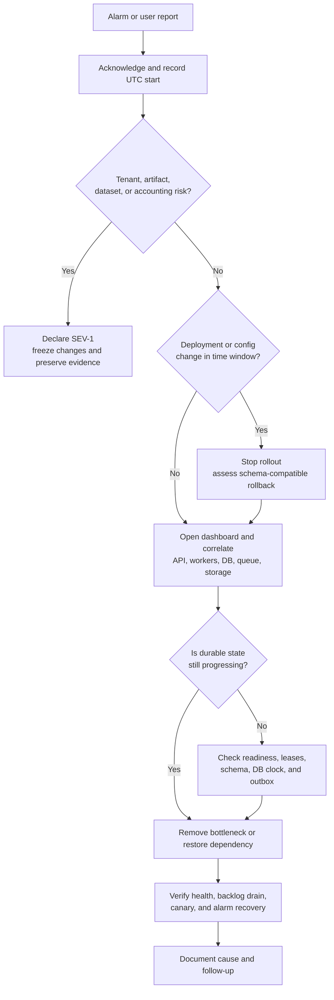
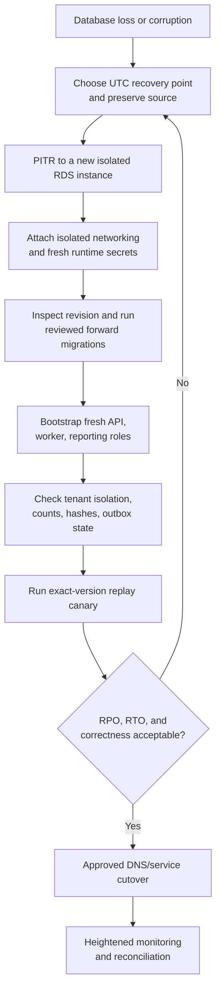

# Production operations runbook

- Status: operational baseline
- Audience: deployers, on-call responders, database operators, and security responders
- Last verified against the repository: 2026-07-29

This runbook covers the AWS deployment defined in `infra/terraform/aws/`. Use the
[architecture guide](../architecture.md) to understand the invariants behind these procedures.
The infrastructure-specific input contract is in
[`infra/terraform/aws/README.md`](../../infra/terraform/aws/README.md).

Replace every uppercase placeholder. Commands assume the operator has selected the intended AWS
account and region and is working from the repository root.

## Safety rules

1. PostgreSQL is the lifecycle authority. Never repair a job by editing `status`, `worker_id`,
   `lease_generation`, `lease_expires_at`, `attempts`, or `result_run_id` by hand.
2. SQS messages contain wake-up hints, not work payloads. Do not infer durable job state from
   queue depth or reconstruct database rows from messages.
3. Never overwrite an artifact or dataset object. A hash mismatch is an integrity incident, not
   permission to replace the object.
4. Never use the worker's `BYPASSRLS` credential for reporting, investigation, or a console.
   Use the API or a `NOBYPASSRLS` reporting role with explicit tenant context.
5. Never give the API or worker the RDS owner secret. The owner credential is restricted to the
   one-shot migration task and audited break-glass recovery.
6. Do not run an unreviewed Alembic downgrade against production. Prefer a forward fix.
7. Do not weaken WAF, RLS, IAM, Object Lock, deletion protection, or TLS to restore availability.
   Escalate and use a reviewed, time-bounded exception if no safe recovery path exists.
8. Preserve logs, task identifiers, image digests, source revisions, object versions, hashes, and
   database timestamps before state-changing incident actions.
9. Do not enable shell tracing while handling tokens, database URLs, or secret values.
10. Every emergency AWS or database change must have an incident record, approver, timestamp,
    reason, and follow-up Terraform reconciliation.

## Operational ownership

The repository defines optional SNS alarm wiring but does not define people, paging schedules,
escalation contacts, or incident communication channels. Before serving production traffic:

- assign a service owner and primary/secondary on-call rotations;
- connect `alarm_sns_topic_arn` to the approved paging destination;
- test alarm delivery from CloudWatch to the final recipient;
- define a private security-incident channel and legal/privacy escalation path;
- assign owners for the canary dataset, OIDC or API-key lifecycle, RDS recovery, and Terraform
  remote state;
- record the current production account, region, DNS name, Terraform workspace/state key, and
  secret ARNs in the approved internal inventory.

During a significant incident, assign:

| Role | Responsibility |
| --- | --- |
| Incident commander | severity, priorities, approvals, communications, and closure |
| Operations lead | AWS, ECS, RDS, S3, SQS, and deployment actions |
| Application lead | API, job lifecycle, engine, persistence, and reproducibility analysis |
| Security lead | tenant exposure, credentials, integrity, evidence, and notifications |
| Scribe | UTC timeline, commands, outputs, decisions, and follow-up actions |

One person may fill multiple roles for a small incident, but the incident commander should not
execute every change during a high-severity event.

## Severity model

| Severity | Examples | Response |
| --- | --- | --- |
| SEV-1 | suspected cross-tenant access; artifact or dataset mismatch; systemic incorrect published results; widespread production loss with material impact | page immediately, freeze changes, appoint incident commander and security/application leads |
| SEV-2 | production API unavailable; invariant alarm; DLQ non-empty; sustained queue growth; repeated lease loss; RDS saturation; artifact backlog beyond objective | page on-call, stop the active rollout if related, begin structured triage |
| SEV-3 | isolated permanent job failure, limited latency degradation, non-production failure, or warning with no correctness impact | investigate during support hours unless impact grows |

`JobFailures` fires for any failed worker attempt and is not automatically SEV-2. Classify its
scope and failure class first. Any sign of tenant isolation, immutable-object integrity, or
accounting failure raises severity.

## Service objectives and indicators

These are initial engineering objectives, not contractual SLOs:

| Objective | Target | Primary evidence |
| --- | --- | --- |
| Control-plane availability | 99.9% successful eligible requests per calendar month | ALB request/target status metrics plus application HTTP metrics |
| Non-streaming API latency | p95 below 2 seconds | ALB `TargetResponseTime` and `qbt_http_request_duration_seconds` |
| Durable job acceptance | p95 below 1 second | application route latency for `POST /v1/jobs` |
| Correctness | zero invariant failures and zero DLQ messages | `InvariantFailures`, `qbt_invariant_failures_total`, and DLQ depth |
| Artifact recovery | pending publications clear within 15 minutes after storage recovery | `ArtifactPublicationDeferred`, job/outbox state, and worker logs |

Authentication, authorization, strict validation, tenant quota, and idempotency-conflict
responses are excluded from the availability numerator and denominator. Server errors, timeouts,
dependency failures, and missing healthy targets are eligible failures.

The Terraform stack creates dashboards and threshold alarms, but it does not deploy a Prometheus
scraper, long-window SLO rollups, or multi-window burn-rate alerts. Before making the objectives
contractual, export the authenticated `/metrics` endpoint to an approved monitoring system,
define exact eligible-status queries, validate label cardinality, and add fast/slow burn alerts.

## Access and prerequisites

An operator needs:

- Terraform 1.10 or newer and access to the externally managed remote-state backend;
- AWS CLI and `jq`;
- permission to read Terraform outputs and inspect ECS, CloudWatch, RDS, SQS, and S3;
- separate, approved permission for Terraform apply, ECS task execution, secret rotation,
  queue redrive/deletion, database break glass, or restore;
- `curl` for health and tenant-scoped API checks;
- `psql` only through an audited private network path and only with the reporting role for
  routine queries;
- the release's full 40-character Git SHA, immutable image digest, SBOM, scan result, and approved
  Terraform plan;
- a non-production and production canary identity, tenant, registered dataset ID, expected
  symbols, and expected result policy.

The Terraform stack intentionally creates no bastion and disables ECS Exec. Do not make RDS
public or enable ad hoc runtime-shell access. Supply a separately reviewed private access path
for database reporting and recovery drills, such as an audited SSM-managed host.

Confirm account and region before every production command:

```bash
aws sts get-caller-identity
aws configure get region
```

From `infra/terraform/aws`, load only non-secret identifiers:

```bash
export QBTOPS_CLUSTER="$(terraform output -raw ecs_cluster_name)"
export QBTOPS_API_SERVICE="$(terraform output -raw api_service_name)"
export QBTOPS_WORKER_SERVICE="$(terraform output -raw worker_service_name)"
export QBTOPS_API_BASE_URL="$(terraform output -raw api_base_url)"
export QBTOPS_QUEUE_URL="$(terraform output -raw job_queue_url)"
export QBTOPS_DLQ_URL="$(terraform output -raw job_dead_letter_queue_url)"
export QBTOPS_DASHBOARD="$(terraform output -raw operations_dashboard_name)"
```

Do not place bearer tokens or database passwords in shared shell profiles, scripts, CI logs, or
Terraform variables.

## Enforced production defaults

The Terraform task definitions currently enforce these limits. Treat them as incident context,
not targets to raise until the downstream database, storage, cost, and abuse impact is reviewed.

| Control | Deployed value |
| --- | --- |
| API request body | 256,000 bytes |
| API blocking executor | 8 threads per task |
| Active jobs per tenant | 20 across `QUEUED`, `RUNNING`, and `WAITING_ARTIFACT` |
| Job attempts | request default 3; deployed API maximum 5; database hard maximum 10 |
| Dataset object | 250,000,000 bytes |
| Symbols per run | 250 |
| Events per run | 2,000,000 |
| Persisted equity points | 100,000 |
| Run wall-clock time | 3,600 seconds |
| Worker lease / polling | 30 seconds / 1 second |
| Queue receive | up to 20-second long poll with a 60-second per-receive visibility override |
| Graceful task stop | 120 seconds |
| API task | 0.5 vCPU and 1 GiB memory |
| Worker task | 2 vCPU, 4 GiB memory, and 50 GiB ephemeral scratch |

Production also forces registered, versioned, hash-bound, sorted, strict-schema datasets and
disables local dataset paths. Most values are explicit task environment entries rather than
operator-time switches; change them through code review, tests, Terraform review, and a capacity
plan.

## First five minutes of an alert



For every page:

1. acknowledge it and record the alarm name, transition time, account, region, and environment;
2. check for tenant-isolation, object-integrity, or accounting risk before treating it as an
   availability issue;
3. stop an in-progress rollout if the signal began during the deployment window;
4. open the operations dashboard and compare API, worker, queue, and RDS signals on the same UTC
   interval;
5. record recent image, task-definition, Terraform, secret, OIDC, WAF, dataset, and database
   changes;
6. preserve representative request IDs, job IDs, run IDs, task ARNs, internal error references,
   log events, and metric screenshots;
7. choose the specific procedure below; do not make speculative database changes.

## Release and deployment

```mermaid
flowchart LR
    Source["Clean source revision"] --> CI["CI and security gates"]
    CI --> Image["Immutable image digest<br/>+ SBOM"]
    Image --> Plan["Reviewed Terraform plan"]
    Plan --> Migration["One-shot migration<br/>+ role bootstrap"]
    Migration --> Services["API and worker rollout"]
    Services --> Health["Health and stability checks"]
    Health --> Canary["Tenant-scoped canary"]
    Canary --> Observe["Observe one alert window"]
    Observe --> Complete["Record release evidence"]
```



### Release gates

Do not deploy unless all required GitHub Actions jobs pass:

- Python 3.11 and 3.13 formatting, lint, type, unit/property/regression tests, and branch coverage;
- PostgreSQL 16 fresh upgrade, Alembic drift check, downgrade-to-base and re-upgrade, plus runtime
  role/RLS integration tests;
- package build/install and typed-package smoke check;
- dependency audit of the locked service requirements;
- Terraform formatting/validation and Docker Compose configuration;
- hardened container startup and readiness smoke test;
- Trivy failure on unfixed `HIGH` or `CRITICAL` findings;
- CycloneDX SBOM generation.

Record:

- exact Git commit;
- image repository and `sha256` digest;
- CI run and security-scan links;
- SBOM artifact;
- Terraform plan checksum and approver;
- current and target Alembic revision;
- migration task ARN and exit code;
- API and worker task-definition revisions;
- canary job/run ID and result hash.

The Terraform variable `container_image` must end in `@sha256:<64 lowercase hex characters>`,
and `source_revision` must be the corresponding full lowercase 40-character Git SHA.

### Initial environment bootstrap

External prerequisites must already exist: remote-state bucket and optional state KMS key, DNS
delegation, ACM certificate, immutable ECR image, distinct API/worker secret ARNs, and either
OIDC settings or API-key/pepper secret ARNs.

1. Initialize the exact backend and select the intended workspace or state key.
2. Create a saved plan with `bootstrap_mode=true`. Review that API and worker desired counts are
   zero while RDS, storage, queues, IAM, networking, monitoring, and the migration definition are
   created.
3. Apply the saved bootstrap plan.
4. Run the migration task using the procedure below. It runs `alembic upgrade head`, then
   bootstraps the API and worker database roles.
5. Require exit code zero and inspect the migration log. The current application expects Alembic
   revision `0011`; the source of truth is `EXPECTED_SCHEMA_REVISION` in
   `src/quant_backtester/persistence/db.py`.
6. Create and review a new full plan with `bootstrap_mode=false`. Production checks require
   Multi-AZ RDS and at least two desired API and worker tasks.
7. Apply, wait for both services to stabilize, then complete health and canary verification.

Example planning shape:

```bash
cd infra/terraform/aws
terraform init \
  -backend-config="bucket=STATE_BUCKET" \
  -backend-config="key=quant-backtester/production.tfstate" \
  -backend-config="region=ap-southeast-2"
terraform fmt -check
terraform validate
terraform plan -out=bootstrap.tfplan \
  -var-file=production.tfvars \
  -var="bootstrap_mode=true" \
  -var="container_image=ACCOUNT.dkr.ecr.REGION.amazonaws.com/quant-backtester@sha256:DIGEST" \
  -var="source_revision=FULL_40_CHARACTER_GIT_SHA"
terraform apply bootstrap.tfplan
```

Never reuse a saved plan after any targeted apply, migration-related infrastructure change, or
state refresh. Generate and review a new plan.

### Run and verify the migration task

Run this from the initialized `infra/terraform/aws` directory. It builds the Fargate network
configuration from Terraform outputs, starts one task in the private subnets with the worker
security group, waits for it to stop, and verifies the `migration` container's exit code.

```bash
export QBTOPS_CLUSTER="$(terraform output -raw ecs_cluster_name)"
export QBTOPS_MIGRATION_DEFINITION="$(terraform output -raw migration_task_definition_arn)"
export QBTOPS_WORKER_SG="$(terraform output -raw worker_security_group_id)"
export QBTOPS_PRIVATE_SUBNETS="$(terraform output -json private_subnet_ids)"
export QBTOPS_NETWORK_CONFIGURATION="$(
  jq -cn \
    --argjson subnets "${QBTOPS_PRIVATE_SUBNETS}" \
    --arg security_group "${QBTOPS_WORKER_SG}" \
    '{awsvpcConfiguration:{
      subnets:$subnets,
      securityGroups:[$security_group],
      assignPublicIp:"DISABLED"
    }}'
)"

export QBTOPS_MIGRATION_START="$(
  aws ecs run-task \
    --cluster "${QBTOPS_CLUSTER}" \
    --task-definition "${QBTOPS_MIGRATION_DEFINITION}" \
    --launch-type FARGATE \
    --network-configuration "${QBTOPS_NETWORK_CONFIGURATION}" \
    --output json
)"

jq -e \
  '(.failures | length) == 0 and (.tasks | length) == 1' \
  <<<"${QBTOPS_MIGRATION_START}"
export QBTOPS_MIGRATION_TASK="$(
  jq -r '.tasks[0].taskArn' <<<"${QBTOPS_MIGRATION_START}"
)"

aws ecs wait tasks-stopped \
  --cluster "${QBTOPS_CLUSTER}" \
  --tasks "${QBTOPS_MIGRATION_TASK}"
export QBTOPS_MIGRATION_RESULT="$(
  aws ecs describe-tasks \
    --cluster "${QBTOPS_CLUSTER}" \
    --tasks "${QBTOPS_MIGRATION_TASK}" \
    --output json
)"
jq -e \
  '[.tasks[0].containers[]
    | select(.name == "migration")
    | .exitCode] == [0]' \
  <<<"${QBTOPS_MIGRATION_RESULT}"
```

Inspect the logs even after a zero exit:

```bash
aws logs tail "/ecs/PROJECT-ENVIRONMENT/migration" \
  --since 30m \
  --format short
```

If task placement fails, inspect `.failures`, private subnet capacity/network paths, execution-role
secret access, NAT reachability, and the worker security group. If the container exits non-zero,
do not deploy services. Preserve its task ARN and logs, identify whether Alembic or role bootstrap
failed, fix forward, materialize a new task definition if needed, and rerun it.

### Routine release

Classify the release before changing production:

- **No schema or runtime-grant change:** review and apply the full Terraform plan, then wait for
  service stability.
- **Backward-compatible schema or runtime-grant change:** materialize and run the new migration
  task before the API/worker service update, then apply a newly generated full plan.
- **Incompatible schema change:** split into expand/migrate/contract releases so old and new tasks
  can safely overlap. If that is impossible, use an approved maintenance window with explicit
  traffic and worker shutdown, recovery point, and rollback decision.

The current single Terraform stack defines migration and service task definitions from the same
image variable but intentionally does not execute the migration. A Terraform-only pipeline can
stage a compatible migration definition with a narrowly reviewed targeted apply:

```bash
terraform plan \
  -target=aws_ecs_task_definition.migration \
  -out=migration-definition.tfplan \
  -var-file=production.tfvars \
  -var="container_image=IMAGE_AT_SHA256" \
  -var="source_revision=FULL_40_CHARACTER_GIT_SHA"
terraform apply migration-definition.tfplan
```

Run and verify that migration, then discard any earlier full plan, create a new full plan with
the same immutable image and source revision, and apply it. Targeted apply is a deliberate staging
mechanism for this stack, not a substitute for full reconciliation. The release record must show
the post-migration full plan/apply. A future deployment pipeline may register the migration task
as a separate stage instead, but it must preserve the same identity and ordering.

After the full apply:

```bash
export QBTOPS_CLUSTER="$(terraform output -raw ecs_cluster_name)"
export QBTOPS_API_SERVICE="$(terraform output -raw api_service_name)"
export QBTOPS_WORKER_SERVICE="$(terraform output -raw worker_service_name)"

aws ecs wait services-stable \
  --cluster "${QBTOPS_CLUSTER}" \
  --services "${QBTOPS_API_SERVICE}" "${QBTOPS_WORKER_SERVICE}"
aws ecs describe-services \
  --cluster "${QBTOPS_CLUSTER}" \
  --services "${QBTOPS_API_SERVICE}" "${QBTOPS_WORKER_SERVICE}" \
  --query 'services[].{service:serviceName,desired:desiredCount,running:runningCount,pending:pendingCount,taskDefinition:taskDefinition,events:events[0:5]}' \
  --output json
```

Confirm desired equals running, pending is zero, new tasks use the expected task-definition
revision, and no rollback or placement event is present.

### Health and canary verification

Check public process and database readiness:

```bash
curl --fail --silent --show-error "${QBTOPS_API_BASE_URL}/health/live"
curl --fail --silent --show-error "${QBTOPS_API_BASE_URL}/health/ready"
```

Then verify:

- ALB targets are healthy in both Availability Zones;
- at least the configured minimum worker count is healthy;
- API target 5xx, p95 latency, queue age, DLQ depth, invariant failures, artifact deferrals, lease
  loss, RDS CPU, and RDS storage are normal;
- the image digest and `QBT_SOURCE_REVISION` match the release record;
- the alarm destination remains configured and no alarm is unexpectedly in `INSUFFICIENT_DATA`.

Submit a small canary using a dedicated researcher identity and a pre-registered, versioned,
hash-verified dataset. Keep the bearer token in a secret-aware shell and never enable `set -x`.

```bash
export QBTOPS_CANARY_DATASET_ID="CANONICAL_DATASET_UUID"
export QBTOPS_CANARY_SYMBOLS='["AAPL","MSFT"]'
export QBTOPS_SOURCE_REVISION="FULL_40_CHARACTER_GIT_SHA"
export QBTOPS_IDEMPOTENCY_KEY="release-${QBTOPS_SOURCE_REVISION}"

export QBTOPS_CANARY_RESPONSE="$(
  jq -cn \
    --arg dataset_id "${QBTOPS_CANARY_DATASET_ID}" \
    --arg run_name "release-${QBTOPS_SOURCE_REVISION}" \
    --argjson symbols "${QBTOPS_CANARY_SYMBOLS}" \
    '{
      dataset_id:$dataset_id,
      max_attempts:1,
      config:{
        symbols:$symbols,
        run_name:$run_name,
        short_window:5,
        long_window:10
      }
    }' |
  curl --fail-with-body --silent --show-error \
    --request POST \
    --header "Authorization: Bearer ${QBTOPS_BEARER_TOKEN}" \
    --header "Content-Type: application/json" \
    --header "Idempotency-Key: ${QBTOPS_IDEMPOTENCY_KEY}" \
    --data-binary @- \
    "${QBTOPS_API_BASE_URL}/v1/jobs"
)"
export QBTOPS_CANARY_JOB="$(
  jq -er '.id' <<<"${QBTOPS_CANARY_RESPONSE}"
)"
```

Poll `GET /v1/jobs/{id}` until `SUCCEEDED`, and fail verification on `FAILED` or `CANCELED`.
Confirm:

- `result_run_id` equals the canary job ID;
- `GET /v1/runs/{id}` succeeds;
- the manifest contains the target source revision and image digest;
- dataset, normalized-data, configuration, strategy, warm-up, and result hashes are present;
- the result hash matches the approved baseline when the semantic inputs and engine-semantics
  version are intentionally unchanged;
- a result-hash change is explained by an approved semantic/version change;
- the immutable artifact exists with the database-recorded size and SHA-256;
- no invariant, lease-loss, artifact-deferred, DLQ, 5xx, or latency alarm fired.

Observe for at least one complete alarm evaluation window after canary success. The longest
configured API/RDS alarm window is 15 minutes.

### Rollback

Application rollback is allowed only when the prior image is compatible with the current schema.

1. Freeze the rollout and preserve failed task/service events, logs, image digest, source revision,
   migration task, and canary evidence.
2. Compare the current database revision with the prior application's supported revision and
   confirm any new columns/tables/values remain readable by the old code.
3. Generate a Terraform plan pinning the previously approved image digest and its matching source
   revision. Review that the plan does not alter or destroy retained data.
4. Apply, wait for stable API and worker services, and run readiness and a new rollback canary.
5. Continue monitoring until backlog, lease, and error signals recover.

Do not automatically execute `alembic downgrade` in production. If the old application cannot
run on the current schema, keep traffic contained and ship a reviewed forward fix. Database
downgrade is a last-resort recovery operation requiring a tested restore, proof that no
new-version writes will be lost, explicit data-owner approval, and a separate execution plan.

## Monitoring reference

The default dashboard contains API requests/errors/latency, worker correctness, queue depth/age,
ECS CPU, and PostgreSQL CPU/connections/storage.

Terraform creates these alarms:

| Alarm suffix | Condition | Initial action |
| --- | --- | --- |
| `job-failures` | `JobFailures` sum > 0 in 5 minutes | classify failure class/code and scope; correlate job logs |
| `invariant-failures` | `InvariantFailures` sum > 0 in 1 minute | stop related rollout; invoke correctness procedure |
| `artifact-publication-deferred` | `ArtifactPublicationDeferred` sum > 0 in 5 minutes | check S3/KMS and pending outbox |
| `job-lease-lost` | `JobLeaseLost` sum > 2 in 5 minutes | check DB latency, worker CPU, network, and heartbeat logs |
| `alb-5xx` | target 5xx sum > 5 for two consecutive 5-minute periods | compare target health, API errors, and RDS |
| `unhealthy-targets` | unhealthy hosts > 0 for two consecutive 1-minute periods; missing data breaches | inspect readiness, ECS events, schema, and DB |
| `queue-age` | oldest wake-up > 300 seconds for two consecutive 1-minute periods | inspect workers and durable `QUEUED` rows |
| `api-p95-latency` | ALB p95 > 2 seconds for three consecutive 5-minute periods | inspect route latency, thread pool, RDS, and task CPU |
| `worker-running-tasks` | running tasks < 1 for two consecutive 1-minute periods outside bootstrap | restore worker service before scaling analysis |
| `dead-letters` | visible DLQ messages > 0 in 1 minute | preserve a sample; invoke DLQ procedure |
| `database-cpu` | average RDS CPU > 80% for three consecutive 5-minute periods | inspect Performance Insights and workload |
| `database-free-storage` | minimum free space < 10 GiB for two consecutive 5-minute periods | stop nonessential growth and plan storage correction |

Alarms exist without actions when `alarm_sns_topic_arn` is null. An alarm visible only in the
console is not an on-call system.

### Structured log queries

API logs are in `/ecs/PROJECT-ENVIRONMENT/api`; worker logs are in
`/ecs/PROJECT-ENVIRONMENT/worker`. JSON event fields are flattened. Useful CloudWatch Logs
Insights queries follow.

Trace one job:

```text
fields @timestamp, level, msg, tenant_id, job_id, run_id, outcome,
       attempt, lease_generation, trace_id, exception
| filter job_id = "JOB_UUID" or run_id = "RUN_UUID"
| sort @timestamp asc
| limit 1000
```

Summarize worker outcomes:

```text
fields @timestamp, outcome
| filter ispresent(outcome)
| stats count(*) as events by outcome, bin(5m)
| sort bin(5m) desc
```

Find correctness and artifact signals:

```text
fields @timestamp, level, msg, tenant_id, job_id, run_id, outcome,
       invariant, exception
| filter invariant = "portfolio_reconciliation"
    or outcome = "artifact_deferred"
    or outcome = "lease_lost"
| sort @timestamp desc
| limit 500
```

Trace an API request:

```text
fields @timestamp, level, msg, request_id, tenant_id, trace_id, exception
| filter request_id = "REQUEST_ID"
| sort @timestamp asc
| limit 500
```

Application logs redact recognized secret fields, but tenant IDs, job IDs, configurations, and
exceptions remain operational data. Export them only to approved incident storage.

### Tenant-safe reporting

Prefer the API. When SQL is required, connect with a separately bootstrapped `reporting` role
through the audited private path. Set transaction-local tenant context before every query:

The default ECS migration task bootstraps only API and worker roles; Terraform does not create a
reporting secret or an operator database-access host. If reporting SQL is an approved
requirement, manage its credential outside Terraform and run
`quant-backtester-db-bootstrap --role reporting` from a reviewed one-shot task or audited private
admin host with the owner connection and `QBT_REPORTING_DB_USERNAME` /
`QBT_REPORTING_DB_PASSWORD` supplied from the secret manager. Re-run reporting bootstrap after
schema changes so explicit grants remain current. If that controlled path does not exist, use the
API and do not substitute worker or owner credentials.

```sql
BEGIN;
SET TRANSACTION READ ONLY;
SELECT set_config('qbt.tenant_id', 'TENANT_ID', true);
SELECT current_setting('qbt.tenant_id', true) AS tenant_context;

SELECT
    status,
    count(*) AS jobs,
    min(created_at) AS oldest_created_at,
    max(updated_at) AS newest_update_at
FROM run_jobs
GROUP BY status
ORDER BY status;

COMMIT;
```

For a specific job:

```sql
BEGIN;
SET TRANSACTION READ ONLY;
SELECT set_config('qbt.tenant_id', 'TENANT_ID', true);

SELECT
    id,
    status,
    attempts,
    max_attempts,
    cancel_requested,
    worker_id,
    lease_generation,
    lease_expires_at,
    last_heartbeat_at,
    next_attempt_at,
    failure_class,
    public_error_code,
    internal_error_ref,
    result_run_id,
    created_at,
    updated_at,
    completed_at,
    clock_timestamp() AS database_now
FROM run_jobs
WHERE id = 'JOB_UUID';

SELECT
    run_id,
    kind,
    status,
    content_hash,
    size_bytes,
    attempts,
    next_attempt_at,
    last_error,
    uri,
    updated_at,
    published_at
FROM artifact_publications
WHERE run_id = 'JOB_UUID';

COMMIT;
```

An empty result with a valid tenant context may mean the resource belongs to another tenant.
Never switch to worker credentials to “confirm” that possibility. Use an approved security
break-glass process if cross-tenant investigation is required.

## Incident procedures

### API unavailable or unhealthy targets

Symptoms include readiness `503`, unhealthy ALB targets, zero healthy hosts, failed ECS
deployments, or connection errors.

1. Compare `/health/live` and `/health/ready`:
   - liveness failure points to task/process/placement;
   - liveness success with readiness failure points to PostgreSQL connectivity or schema.
2. Inspect API service desired/running/pending counts, recent ECS events, stopped task reasons,
   container exit codes, and health-check output.
3. Inspect API logs for startup validation, database TLS/connectivity, authentication
   configuration, and expected-schema errors.
4. Check RDS instance availability, connections, CPU, storage, failover events, security-group
   changes, NAT/DNS health, and Secrets Manager access.
5. If failures are request-specific, inspect WAF blocked counts and ALB access logs. Do not disable
   a managed rule globally; identify the exact rule and input first.
6. If the incident follows a release, execute schema-compatible rollback. If it follows a secret
   change, complete or revert the coordinated secret/role rollout.
7. Verify both health endpoints, healthy targets across AZs, an authenticated read, and a canary.

The application intentionally fails closed on a schema mismatch. Do not enable automatic schema
creation or bypass readiness; run the reviewed migration task.

### Elevated API 5xx or p95 latency

1. Split the time range by ALB target status, route, response status, task CPU/memory, database
   CPU/connections, and deployment revision.
2. Use request IDs and traces to determine whether latency is authentication/JWKS, the bounded
   blocking executor, database locks/queries, or network dependency time.
3. Check the API task count and autoscaling activity. The target is 60% average CPU, with minimum
   two tasks and maximum ten in the default stack.
4. Check RDS Performance Insights before scaling API tasks. More API concurrency can worsen a
   database bottleneck.
5. Confirm the p95 breach is not a WAF block or expected client validation response.
6. Roll back a causal release when schema-compatible; otherwise reduce the offending workload or
   ship a forward fix.
7. Verify p95 and 5xx recovery for a full evaluation window and run the canary.

### Queue age increasing or workers absent

SQS depth is only a hint. Correlate it with durable job counts.

1. Check worker desired/running/pending count, health, stopped-task reasons, deployment events,
   CPU/memory, and autoscaling activity.
2. Read queue attributes for visible, in-flight, and delayed messages:

   ```bash
   aws sqs get-queue-attributes \
     --queue-url "${QBTOPS_QUEUE_URL}" \
     --attribute-names \
       ApproximateNumberOfMessages \
       ApproximateNumberOfMessagesNotVisible \
       ApproximateNumberOfMessagesDelayed
   ```

3. Use the dashboard for `ApproximateAgeOfOldestMessage`; it is a CloudWatch metric, not a
   `GetQueueAttributes` field.
4. Query tenant-scoped `QUEUED`, `RUNNING`, and `WAITING_ARTIFACT` counts. A low SQS count with
   queued database rows is recoverable because workers poll PostgreSQL every second by default.
5. Check worker logs for queue receive/acknowledgement errors, database claims, schema health,
   dataset failures, lease loss, or artifact recovery dominating the loop.
6. Confirm RDS and S3 are healthy before increasing workers. Worker autoscaling targets one
   visible wake-up per task, with a configurable maximum of 20 by default.
7. Correct durable capacity through reviewed Terraform/autoscaling configuration. Record and
   later reconcile any emergency scaling override.
8. Verify the oldest durable queued time and SQS age both decline, not merely message count.

Do not recreate jobs from SQS bodies. The worker acknowledges a valid wake-up before attempting
the database claim, so queue disappearance is not evidence of job completion.

### Jobs remaining `RUNNING` or repeated lease loss

The default deployed lease is 30 seconds and heartbeats occur at roughly one-third of the lease.

1. Inspect the job's `worker_id`, generation, expiry, last heartbeat, attempt count, and database
   `clock_timestamp()` using the tenant-safe query.
2. Correlate that worker task with CPU/memory pressure, task stop events, database latency,
   network interruptions, and `lease_lost` logs.
3. If the lease is still valid, allow the owner to continue. Do not alter its fields or start a
   duplicate run.
4. If expired, allow the opportunistic reaper in normal worker claims to derive the next state.
   It will requeue, fail, cancel, wait for artifact, or succeed from durable evidence.
5. Confirm a subsequent claim increments `lease_generation`; stale owner transitions must be
   rejected.
6. Repeated loss across workers indicates database latency, CPU starvation, network instability,
   or an operationally unsuitable lease. Fix the resource cause before considering a reviewed
   lease-duration change.
7. Verify normal heartbeat cadence and no new lease-loss events for at least two alarm windows.

Worker shutdown is cooperative: ECS provides 120 seconds, the worker releases an interrupted
lease, and an administrative shutdown does not consume an attempt. Forced termination may leave
the lease for the reaper.

### Jobs in `WAITING_ARTIFACT`

1. Query the job and `artifact_publications` row. Confirm the run ID, pending status, content hash,
   byte count, attempt count, next attempt, and last error.
2. Inspect worker logs for `artifact_deferred`, S3 status, KMS denial, timeout, conditional-write
   failure, or verification mismatch.
3. Check artifact-bucket health, worker task IAM, KMS key state/policy, NAT path, regional events,
   object versioning, and Object Lock configuration.
4. Restore the dependency or permission. Workers process due publications before new compute and
   retry with deterministic bounded backoff.
5. Do not resubmit the simulation, modify outbox payload/hash/size, or overwrite the S3 key.
6. If an object already exists with different bytes or metadata verification fails, declare an
   integrity incident and preserve both database and S3 evidence.
7. Verify the outbox becomes `PUBLISHED`, a `run_artifacts` record exists, and the non-canceled
   job reconciles to `SUCCEEDED`.
8. Confirm the oldest pending publication clears within 15 minutes of storage recovery.

Canceling a waiting job makes the job terminally `CANCELED`; its staged evidence may still be
published but cannot resurrect the job.

### Job failures

1. Identify `failure_class`, `public_error_code`, `internal_error_ref`, attempts, and the first
   exception in the worker logs.
2. Classify scope: one dataset/configuration, one tenant, one worker revision, or all jobs.
3. Permanent input/schema/compute-limit failures should not be retried. Give the caller the stable
   public code and retain internal detail in approved systems.
4. Transient failures requeue only while attempts remain; verify `next_attempt_at` and avoid
   resubmitting with a new idempotency key.
5. Invariant failures do not retry as transient. Follow the correctness procedure.
6. If a run/outbox was already committed, recover publication instead of computing again.
7. Close a single-job incident only after identifying whether user input, dataset registration,
   infrastructure, or application logic must change.

### Accounting or execution invariant failure

Treat a new invariant failure as at least SEV-2 and as SEV-1 when an incorrect result may have
been published, shared, or produced systemically.

1. Stop the related rollout and prevent further exposure of suspect result artifacts through the
   approved incident process.
2. Preserve the image digest, source revision, engine and semantics versions, full manifest,
   configuration hash, dataset URI/version/hash, warm-up hash, strategy hash, RNG seed/stream,
   result hash, orders, fills, equity snapshots, journal entries, artifact bytes, and internal
   error reference.
3. Determine the affected semantic-version, image, tenant, dataset, and time ranges. Do not assume
   a single failing canary is isolated.
4. Reproduce in an isolated environment with the recorded image and exact dataset object version.
5. Compare normalized data, per-order RNG identity, order/fill ledgers, journal balance, end-of-run
   policy, and fixed-precision persisted values.
6. Do not mark failed jobs successful or edit financial records. Ship a tested forward fix and
   decide whether engine-semantics version must increase.
7. Before reopening, pass regression/property tests, replay affected samples, deploy a canary,
   and confirm zero invariant events for the agreed observation period.
8. Document impact and whether prior results require invalidation or customer notification.

### Dead-letter queue non-empty

The DLQ retains wake-up messages for 14 days and receives a message after five failed receives.

1. Record DLQ depth and alarm time. Receive a small sample without deleting it and preserve body,
   message ID, receive count, and timestamps in restricted incident evidence.
2. Validate the schema-v1 body has a canonical `job_id` and permitted `tenant_id`. Invalid bodies
   indicate an unauthorized producer, corruption, or incompatible publisher.
3. For each valid sample, inspect the tenant-scoped durable job through the API/reporting role.
4. Check worker logs for parse failures and acknowledgement failures. A valid job may already
   have progressed through database polling.
5. Fix the producer, consumer, IAM, or availability cause before redrive.
6. Choose one reviewed action:
   - redrive valid hints when lower wake-up latency is useful;
   - delete obsolete hints only after durable rows are verified terminal or independently
     progressing;
   - retain suspicious messages as evidence.
7. Queue redrive or deletion requires incident approval because it mutates evidence. Never create
   or update `run_jobs` from the message.
8. Verify DLQ depth returns to zero and the database backlog drains.

### RDS CPU, connections, or free storage

1. Check RDS events, Multi-AZ/failover state, CPU, connections, free storage, I/O, and Performance
   Insights over the same interval.
2. Correlate with API request rate, active jobs, worker count, artifact reconciliation, migrations,
   and reporting queries.
3. Stop or cancel nonessential reporting at its source. Runtime roles already have connection
   limits and 30/120-second statement timeouts.
4. Do not add API/worker concurrency until the database bottleneck is understood.
5. For CPU or connection pressure, optimize/rollback the causal workload or change instance
   capacity through reviewed Terraform.
6. For free storage, confirm storage autoscaling bounds (`allocated_storage` to
   `max_allocated_storage`), unexpected table/index/log growth, and AWS scaling eligibility.
   Increase bounds/capacity through a reviewed plan; do not delete audit, run, or outbox rows.
7. Allow normal RDS failover when required; readiness will remain closed until connections work.
8. Verify connections, CPU, free storage, queue age, API latency, and lease loss recover together.

### Suspected tenant exposure

Declare SEV-1.

1. Preserve API, WAF, ALB, database, audit, and identity-provider evidence with UTC boundaries.
2. Restrict affected ingress or identities through the approved security process; do not destroy
   sessions or logs before evidence capture when continued exposure is not occurring.
3. Rotate affected API keys, database identities, OIDC client configuration, or AWS roles as
   indicated.
4. Using audited database-owner break glass, verify API/reporting roles are `NOBYPASSRLS`, tenant
   tables have RLS enabled and forced, policies match the migrated definitions, and same-tenant
   foreign keys exist.
5. Reproduce authorization checks with two controlled tenants, including run-child reads and
   guessed UUIDs. A foreign tenant resource must be indistinguishable from absent.
6. Determine affected tenants, records, routes, identities, time range, and exported artifacts.
7. Follow organizational legal, privacy, and customer-notification requirements.
8. Restore access only after security review, forced-RLS integration tests, credential rotation,
   canary validation, and heightened monitoring.

### Immutable object integrity mismatch

Declare SEV-1 for a dataset or artifact hash/size mismatch.

1. Stop related publication or execution without deleting either version.
2. Capture bucket, key, version ID, ETag, size, KMS key, Object Lock state, database hash/size,
   manifest, run/job ID, CloudTrail data events if enabled, and worker logs.
3. Download the exact version into isolated evidence storage and calculate SHA-256 independently.
4. Determine whether the mismatch is at registration, download, serialization, upload,
   pre-existing-object verification, or database record.
5. Review IAM and producer identities. Workers cannot delete objects and publish artifacts only
   under `runs/`; dataset publication is external to this service.
6. Do not overwrite the key. Correct references with a new version and reviewed registration or
   publish path only after impact analysis.
7. Identify every job/result that consumed or referenced the affected version and decide whether
   to invalidate results.

### Incident recovery and closure

Do not close an incident because one alarm returned to `OK`.

1. verify the user-visible symptom is gone from an independent client;
2. verify API health, service stability, durable backlog age, lease cadence, artifact backlog,
   DLQ, RDS, and the release canary;
3. observe for at least the longest relevant alarm window and confirm no hidden retry backlog;
4. record the final affected tenant/job/run/object/time scope and correctness assessment;
5. reconcile or remove every emergency AWS/configuration change through reviewed Terraform;
6. rotate or revoke temporary credentials and close break-glass sessions;
7. preserve the UTC timeline, commands, logs, metrics, hashes, task definitions, images, and
   approvals under the incident-retention policy;
8. assign corrective actions with owners and dates, including tests, alarms, capacity, runbook,
   security, or architecture changes;
9. hold a blameless review for SEV-1/SEV-2 incidents and validate action completion.

## Backup, restore, and disaster recovery

The recovery set is:

- RDS automated backups and point-in-time recovery with 30-day retention;
- the retained final snapshot and deletion protection;
- versioned, KMS-encrypted dataset and artifact buckets;
- default Object Lock governance retention (30 days for datasets and 365 days for artifacts);
- immutable application images, source revisions, Terraform state/configuration, secrets, and
  the result manifests that bind these components.



### Quarterly recovery drill

At least quarterly:

1. select a recovery point and record the expected recovery point objective and recovery time
   objective; the repository does not define either commitment;
2. restore RDS to a new identifier in an isolated VPC/subnet/security group with no production
   service access;
3. use fresh API, worker, and reporting secrets; never copy the RDS owner secret into a runtime
   task;
4. inspect Alembic revision, then apply only reviewed forward migrations required by the drill
   image;
5. rerun runtime-role bootstrap and verify forced RLS with two-tenant integration checks;
6. compare tenant-scoped table counts and sample job/run relationships at the chosen recovery
   time;
7. verify exact versions and SHA-256 values for representative datasets and artifacts;
8. inspect `RUNNING`, `QUEUED`, and `WAITING_ARTIFACT` rows. In an activated recovery environment,
   workers/reaper must reconcile them from leases and outbox state;
9. replay a canary using its recorded image, dataset version, configuration, strategy, and RNG
   identity; compare the deterministic result hash;
10. record actual recovery point, recovery duration, manual steps, missing permissions, data
    discrepancies, and corrective actions;
11. destroy drill compute/network resources only after evidence retention is approved. Snapshot
    and Object Lock retention may prevent or intentionally delay data deletion.

### Production restore

Restore to a new RDS instance; do not restore over the source. Keep the candidate isolated until
validation succeeds. A point-in-time database may not align exactly with the latest S3 writes:
the outbox and artifact records are the reconciliation boundary.

Before cutover:

- confirm expected schema/application compatibility;
- verify RLS policies, grants, triggers, constraints, and runtime role properties;
- confirm dataset registrations point to retained exact versions;
- verify published artifact hashes and pending outbox bytes;
- allow expired `RUNNING` rows to be reaped only after the recovered environment is intentionally
  activated;
- run authenticated API reads and the deterministic replay canary;
- record DNS/connection changes and a rollback path to the untouched source.

After cutover, monitor errors, latency, connections, queue age, lease loss, artifact recovery,
DLQ, and canary results. Retain the source for the approved evidence window.

## Dataset publication and canary maintenance

Production accepts only registered dataset objects under the configured `datasets/` prefix.

1. Validate the CSV with strict schema, ordering, symbol, timestamp, price, duplicate, and size
   policies before upload.
2. Calculate lowercase SHA-256 over the exact bytes.
3. Upload under a new key or version; rely on bucket KMS encryption and Object Lock. Capture the
   returned `VersionId`.
4. Construct `s3://BUCKET/datasets/KEY?versionId=ENCODED_VERSION_ID`, percent-encoding the version
   ID for a URI query.
5. Register it through `POST /v1/datasets` with name, exact hash, schema version `1`, source URI,
   and non-sensitive metadata.
6. Read the registration back and compare every field.
7. Submit a small job and confirm worker download hash, run data hash, manifest, and result
   publication.

Example registration body:

```json
{
  "name": "production-canary-v1",
  "content_hash": "LOWERCASE_64_CHARACTER_SHA256",
  "source_uri": "s3://DATASET_BUCKET/datasets/canary/prices-v1.csv?versionId=ENCODED_VERSION_ID",
  "schema_version": 1,
  "metadata": {
    "purpose": "release-canary",
    "owner": "SERVICE_OWNER"
  }
}
```

Treat the canary dataset ID and expected baseline result hash as controlled release inputs.
Changing bytes, symbols, configuration, engine semantics, strategy source, or RNG version requires
a reviewed baseline update; do not silently accept a changed hash.

## Credential and key rotation

### API and worker database identities

Prefer blue/green usernames for zero-downtime rotation:

1. create a new long random password and a new safe role username in the externally managed
   secret for one runtime identity;
2. materialize and run the migration task so role bootstrap creates the new role with exact
   grants and role attributes;
3. deploy only the corresponding runtime tasks with the updated secret and wait for stable
   connections;
4. verify readiness, tenant isolation, job processing, and audit writes;
5. allow old tasks/connections to drain;
6. through audited owner access, disable and later drop the old login after confirming no
   sessions or task definitions use it;
7. record the rotation and repeat independently for the other runtime identity.

If the username is unchanged, role bootstrap changes its password immediately. Coordinate task
replacement because existing connections may continue while new connections with the old
password fail. Never rotate API and worker to a shared role.

The migration task bootstraps both API and worker roles from their current secrets, so both
secrets must remain valid during either rotation.

### API keys and pepper

Stored API-key digests are `SHA-256(pepper || token)`. The implementation accepts one active
pepper, so changing it invalidates every existing digest.

1. inventory keys, tenant/role mappings, key IDs, owners, and expiry;
2. generate new high-entropy tokens and a random pepper of at least 32 characters;
3. calculate and store only the new digests in the API-key JSON secret;
4. distribute tokens through the approved secret channel;
5. coordinate both secret updates and API task rollout as one cutover;
6. validate each required role/tenant and revoke old material;
7. investigate use of expired or old key IDs.

For lower-disruption enterprise rotation, prefer OIDC or implement an explicitly reviewed
multi-pepper transition before relying on it.

### OIDC, TLS, KMS, and image access

- OIDC signing-key rotation is consumed through the issuer's JWKS cache. Monitor issuer/JWKS
  errors, preserve overlap according to the identity provider's policy, and test audience,
  tenant, and role claims.
- Renew/rotate the ACM certificate before expiry and verify hostname coverage and HTTPS health.
- The application KMS key has AWS rotation enabled. Review grants/policy and test decrypt/write
  paths after access-policy changes.
- Rotate IAM credentials by using roles and short-lived sessions; do not create static task keys.
- Keep ECR tags immutable and deploy by digest. Retain images needed to reproduce retained runs;
  the default lifecycle keeps the most recent 100 images, which must be reconciled with the
  organization's reproducibility-retention requirement.

## Capacity and routine maintenance

### Weekly

- review alarm state, notification delivery, dashboard gaps, DLQ depth, oldest queue age, failed
  job codes, lease loss, and pending artifact age;
- review ECS deployment events and desired/running counts;
- review RDS CPU, connections, storage, backups, maintenance events, and Performance Insights;
- confirm canary success and expected result hash;
- triage dependency, image, and infrastructure security findings.

### Monthly

- test one paging route;
- review API-key/OIDC identities, role mappings, expired keys, and secret access;
- verify Terraform state backup/locking and plan drift;
- sample RLS/audit behavior and immutable object metadata;
- compare capacity limits with observed request, dataset, event, run-time, and artifact sizes;
- confirm log, backup, object, image, and incident-evidence retention meet policy.

### Quarterly

- perform and time the recovery drill;
- exercise schema-compatible application rollback in staging;
- test worker termination, lease reaping, SQS loss/duplicate handling, and S3 publication recovery;
- run two-tenant isolation tests against a production-equivalent PostgreSQL environment;
- review service objectives, exclusions, alert thresholds, burn-rate coverage, and capacity
  forecasts.

Scale API tasks only after separating CPU saturation from database or OIDC latency. Scale workers
only after checking RDS, dataset S3, artifact S3, and job duration. The default API target is 60%
CPU with two-to-ten tasks. Worker target tracking uses one visible SQS message per task, minimum
at least one (two desired in production), and maximum 20. Because SQS is only a wake-up channel,
also track durable job age/count before capacity decisions.

## Retention and decommissioning

Current infrastructure defaults:

| Data | Retention/control |
| --- | --- |
| RDS automated backups | 30 days plus retained final snapshot |
| Dataset object versions | Object Lock governance default 30 days |
| Artifact object versions | Object Lock governance default 365 days; noncurrent archival/expiry lifecycle |
| ALB access logs | 365-day lifecycle |
| CloudWatch application/WAF logs | 90 days |
| DLQ messages | 14 days |
| Main SQS wake-ups | 4 days |
| ECR images | most recent 100 |

Before decommissioning:

1. stop new submissions through an approved control-plane change;
2. wait for or explicitly cancel active jobs through the API;
3. confirm no `RUNNING`, `QUEUED`, or `WAITING_ARTIFACT` work remains;
4. export the tenant and retention inventory, manifests, hashes, audit evidence, SBOMs, image
   digests, and source revisions required by policy;
5. create and verify the final RDS snapshot and object inventory;
6. revoke user identities and runtime roles after workloads stop;
7. decide who owns retained KMS keys, secrets, DNS, Terraform state, snapshots, buckets, logs, and
   images;
8. obtain data-owner/security approval for every deletion or governance-retention bypass;
9. execute a reviewed decommission plan. Terraform `prevent_destroy`, RDS deletion protection,
   final snapshots, versioning, and Object Lock intentionally prevent a casual destroy;
10. verify billing resources and retained evidence, then close with an auditable record.

Do not use `terraform destroy` as a decommissioning plan.

## Local Docker Compose operations

Local Compose is a development environment, not a production recovery substitute.

```bash
cp .env.example .env
docker compose --env-file .env -f infra/docker/docker-compose.yml up --build --detach
docker compose --env-file .env -f infra/docker/docker-compose.yml ps
curl --fail --silent --show-error http://127.0.0.1:8000/health/ready
docker compose --env-file .env -f infra/docker/docker-compose.yml logs --tail=200 api worker migrate
```

The one-shot `migrate` service must complete before API and worker start. If it fails, inspect its
logs and correct credentials or migrations; do not bypass the dependency.

To stop containers while retaining named PostgreSQL and artifact volumes:

```bash
docker compose --env-file .env -f infra/docker/docker-compose.yml down
```

`docker compose down --volumes` deletes the local database and artifact volumes. Use it only for
an explicitly disposable environment after confirming the exact Compose project.
